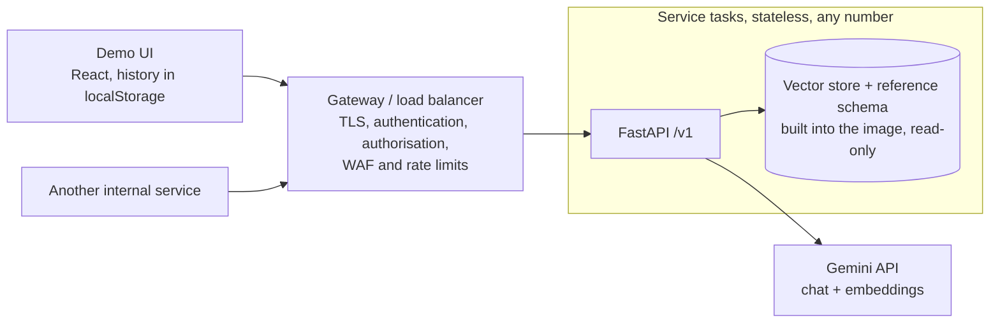
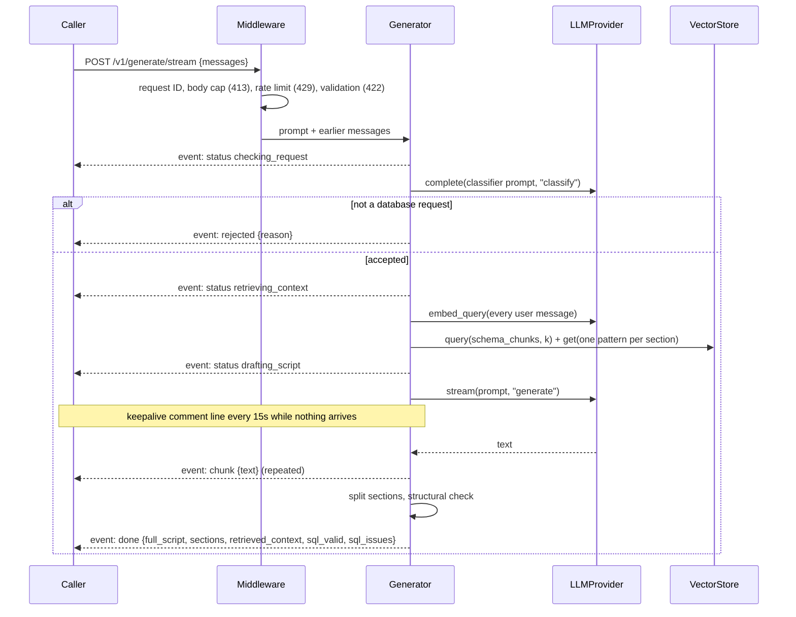

# Architecture

The service turns a plain-English request into a PL/pgSQL stored procedure,
grounded in a reference schema and a library of house-style patterns. It is
built to be one component of a larger system: it has a versioned contract
(`/v1`, [`openapi.json`](openapi.json)), keeps no state, and depends on
three swappable interfaces rather than on particular vendors.

What exists today runs locally with `docker compose`. The AWS deployment
described below (ALB, ECS Fargate, CloudFront) is **planned** (Phase 5 in
[`MIGRATION_STATUS.md`](../MIGRATION_STATUS.md)), not built.

## Where it sits



**The gateway owns authentication and authorisation.** The service has no
auth code by design: it trusts any request that reaches it, so it must only
be reachable through something that has already decided the caller may use
it. In the planned AWS deployment that is an ALB; authentication there would
be the ALB's OIDC/Cognito integration or an identity-aware proxy in front of
it (neither is built). An ALB rather than API Gateway because API Gateway's
default 29-second integration timeout is below the service's 200-second
generation timeout. Per-caller quotas also belong at the gateway or WAF; the
service's own token bucket (`app/ratelimit.py`) is a per-task fallback, keyed
on client IP, and honours `X-Forwarded-For` only when `TRUST_FORWARDED_FOR`
says the proxy in front is trusted.

## The caller owns the conversation

The service stores nothing between requests. Each request carries the
conversation so far, ending with the new request:

```json
{ "messages": [
    { "role": "user", "content": "Process payroll for a given pay period" },
    { "role": "assistant", "kind": "generation", "full_script": "-- SECTION: PRE_VALIDATION ..." },
    { "role": "user", "content": "Also skip employees who are on leave" } ] }
```

Consequences:

- Any task can serve any request, so the service scales by adding tasks and
  a deploy loses no data. There is no database to provision or back up.
- To regenerate an answer, the caller resends the conversation without the
  last assistant message. To branch, it sends a different prefix.
- The caller decides where history lives and who can see it. The demo UI
  keeps it in the browser's localStorage; a server-side caller would keep it
  in its own store, under its own access rules.
- Requests grow with the conversation: every earlier script travels in the
  body. `MAX_REQUEST_BYTES` (256 KB) allows roughly 25 turns.

## Request flow

`POST /v1/generate/stream`. `/v1/generate` is the same pipeline, answered
in one JSON response at the end.



A failure during the stream ends it with `event: error {code, message,
request_id}` instead of `done`. Generation is retried once, and only for a
429 or 5xx that arrived within 30 seconds and before any text was sent
(`app/rag/retry.py`). Typical timings at the default thinking level: about
2.5s to classify, 1s to retrieve, 10-15s to generate.

## Swapping parts

The pipeline depends on three interfaces in `backend/app/adapters/base.py`:

| Interface | Implementation today | Selected by |
|---|---|---|
| `LLMProvider`: complete, stream, embed | Gemini, `adapters/gemini.py` | `LLM_PROVIDER=gemini` |
| `VectorStore`: sync, query, get, count | Chroma on local disk, `adapters/chroma.py` | `VECTOR_STORE=chroma` |
| `SchemaSource`: tables, available | SQLite reference DB, `adapters/sqlite_schema.py` | `SCHEMA_SOURCE=sqlite` |

To swap one, write a class with the same methods and add a branch for it in
`backend/app/adapters/__init__.py` and a value to the setting's `Literal` in
`app/config.py`. Nothing else imports a vendor SDK for these jobs, with one
exception: `app/errors.py` maps google-genai, httpx and Chroma exceptions to
the service's error codes, so a new implementation either raises those or
gets its own mapping there. Only one implementation of each exists; the
seams are there so a second one is a contained change, not a rewrite.

The vector store and reference schema are built into the image at build
time (`python -m app.rag.ingest`) and only read at runtime, which is what
lets every task be identical. A shared, writable store (a managed vector
database, a live schema catalogue) would be a new `VectorStore` or
`SchemaSource`, and ingest would become a job rather than a build step.

## Observability

Every response carries `X-Request-ID` (the caller's, if it sent a sane one),
and every log line is one JSON object carrying it. At INFO, prompts are
logged only as a length and a hash (the full text appears only at DEBUG). Each generation emits one CloudWatch Embedded Metric
Format line (namespace `SPGenerator`, by endpoint and outcome); off AWS it
is an ordinary log line. `/health` is liveness with no dependencies;
`/ready` checks configuration and the local corpora without calling Gemini.
