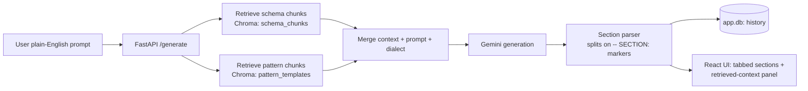

# RAG Stored Procedure Generator — Overview

This is a planning note, not a spec. Treat everything here as a suggested starting
point you can push back on as you build — nothing is locked in except the
decisions marked "Decided" below.

## What this project demonstrates

The point of this build is to show RAG judgment, not just "call an LLM." The
interesting part is that there are **two distinct retrievable corpora** feeding
one generation:

1. A **schema corpus** — grounds the LLM in what tables/columns actually exist,
   so it doesn't hallucinate column names.
2. A **pattern corpus** — a small, self-authored library of best-practice SQL
   snippets (pre-validation, temp tables, backup, post-validation, rollback)
   that ground the LLM in *how* a well-written stored procedure is structured.

Retrieving from both and merging them into one prompt is the crux of the demo.
Worth designing the retrieval/merge step carefully — it's the part most likely
to get evaluated closely.

## Decided so far

- Reference schema DB is **metadata-only** (SQLite) — nothing gets executed
  against it.
- The whole project standardizes on a **single dialect: PL/pgSQL** — no
  per-request dialect parameter or UI selector. Enterprises typically run one
  engine per database, so this isn't a real constraint being modeled away.
- Reference schema domain is **HR / payroll** — see
  `03a-reference-schema-design.md`.
- Generation output is a **single script with comment-marker sections**
  (`-- SECTION: PRE_VALIDATION`, etc.), parsed server-side into a dict for the
  frontend to render as tabs.
- Pattern-corpus retrieval is a **deterministic per-category pull** (one
  chunk per category, filtered by metadata), not similarity search — schema
  retrieval stays similarity-based.
- Orchestration uses **LangChain + langchain-google-genai**, consistent with
  `04 - Data Ingestion to Vector DB Pipeline`.

## Suggested high-level flow

> **Superseded in part (Phase 3).** The `app.db: history` node below no
> longer exists: the service is stateless, the caller sends the conversation
> with each request, and the demo UI keeps history in localStorage. The UI
> shows the script with its section markers rather than tabbed sections.
> See [`docs/ARCHITECTURE.md`](../docs/ARCHITECTURE.md) for the current flow.



## Folder layout at the project root

```
05 - RAG Project/
  planning/     <- you are here
  frontend/     <- React + JSX
  backend/      <- FastAPI + RAG pipeline
    db/         <- schema seed scripts, sample data, migration notes
```

(`db/` was originally planned as a project-root sibling; it now lives under
`backend/`, since it's only ever consumed by the backend. See
`backend/README.md` for the actual layout.)

Read `01-frontend.md`, `02-backend.md`, `03-db-and-rag.md` (+
`03a-reference-schema-design.md`), and `04-genai-prompting.md` for the
per-component notes. `05-open-questions.md` tracks things still worth
deciding before or during the build.
